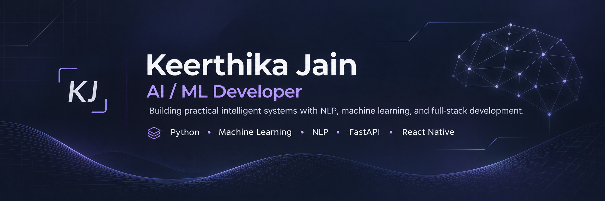
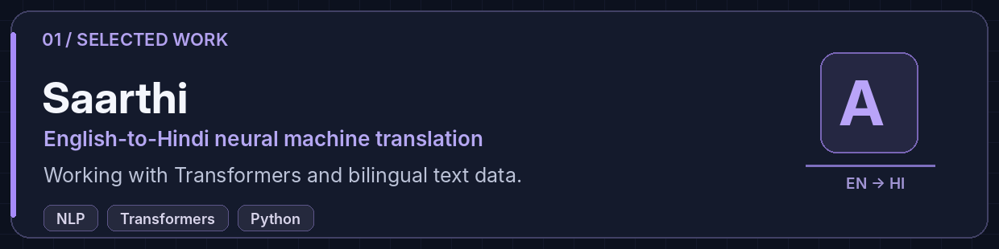
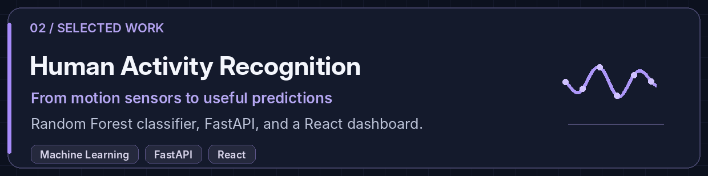
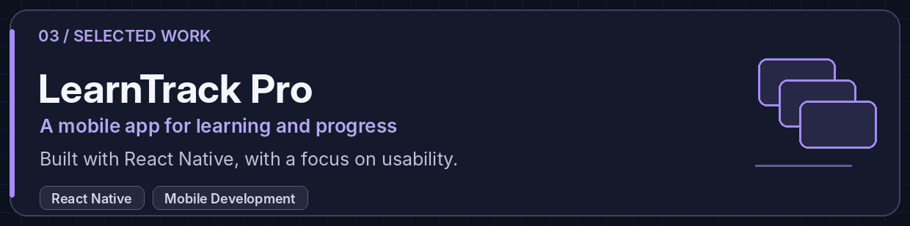

  

    
  
  

---

## About me

I'm Keerthika, a Computer Science student interested in the overlap between **machine learning and software engineering**. I like getting past the point where something works and finding out *why* it works, where it fails, and how to make it better.

I've learned a lot by building: experimenting with sensor data, working on an English-to-Hindi translation model, and making web and mobile applications. These days I'm spending more time on fundamentals, testing my assumptions, and reading other people's code.

> The part I enjoy most is taking an experiment and making it useful to someone else.

---

## Tech stack

**Languages**

**Machine learning & data**

**Web, mobile & APIs**

**Databases & developer tools**

---

## Selected work

**[Saarthi](https://github.com/keerthikajain/Neural-Machine-Translation-System)** · *In progress*  
English-to-Hindi neural machine translation using a Transformer. The work includes preparing parallel text, cleaning the dataset, and connecting the translation pipeline to a usable interface.

 

**[Human Activity Recognition](https://github.com/keerthikajain/HARtraining)**  
A classification system using smartphone accelerometer and gyroscope readings. I trained a Random Forest model (~**94% accuracy** in an initial evaluation), explored PCA and clustering, and built a FastAPI + React interface for predictions.

 

**[LearnTrack Pro](https://github.com/keerthikajain/LearnTrack-Pro)**  
A React Native app for organizing learning and tracking progress. Building it pushed me to think about navigation, application structure, and the small details that make an app usable.

---

## Beyond the projects

- Strengthening **data structures, algorithms, and CS fundamentals**.
- Learning how to evaluate ML models beyond one accuracy number.
- Reading unfamiliar codebases and working toward useful **open-source contributions**.
- Writing code that's easier to test, maintain, and explain.

---

## GitHub activity

  
    
  <a href="https://github.com/keerthikajain?tab=overview">View my contributions on GitHub</a>

---

  <strong>Open to talking about code, interesting problems, and open-source projects.</strong>
    
  

